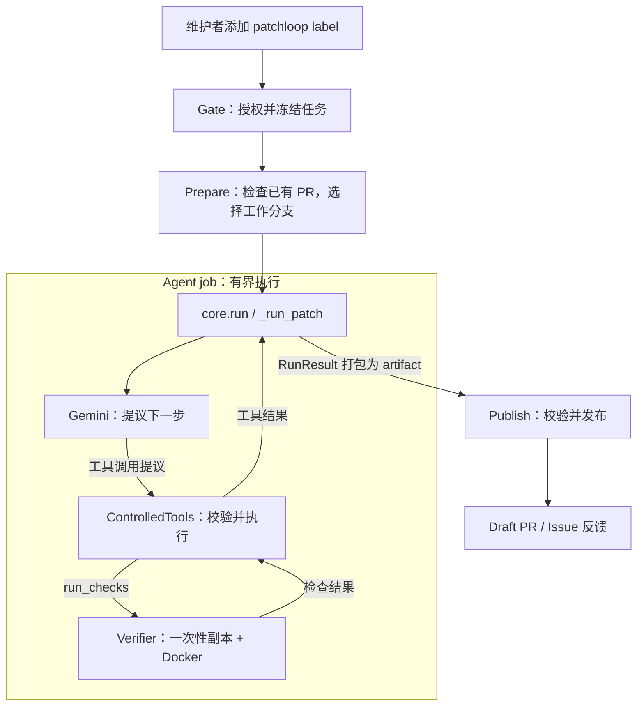

# PatchLoop 架构概览

PatchLoop 将维护者明确授权的 GitHub Issue，处理为可供人工审查的 Draft PR，或给出
澄清、无需修改和失败反馈。它用受控工具、预算、验证和发布规则约束模型提出的行动。

## 1. 整体架构

PatchLoop 由 **Python 3.12 CLI** 和 **GitHub Actions reusable workflow** 组成。
PatchLoop 源码仓库提供程序与 workflow；目标仓库保存 Issue、`.patchloop.yml` 和
caller workflow，并接收修改结果。GitHub Actions 在维护者自己的账户中运行这些 job。
目标仓库的 [caller](../examples/patchloop-caller.yml) 监听 `issues: labeled`，筛选
`patchloop` label 并检查专用 Secret 是否存在，再调用 reusable workflow。

workflow 有 `gate`、`prepare`、`agent`、`publish` 四个 job。
**Verifier 在 Agent job 内被调用**，承担独立的目标代码执行边界。

## 2. 一次运行如何完成

| 阶段 | 主要责任 | 交给后续阶段的数据 |
| --- | --- | --- |
| Gate | 确认 labeled event、`patchloop` label 和触发者的 `write`/`admin` 权限，冻结 Issue 与评论 | 任务快照、授权报告、发布上下文 |
| Prepare | 检查 `patchloop/issue-<number>` 的 branch/PR 状态；新任务从默认分支开始，兼容的活跃 Draft PR 从已有分支继续 | 是否继续、checkout ref |
| Agent | 加载配置，由 Gemini 提议动作，受控工具读取和修改工作区，并请求验证 | patch、验证证据、Run Report、发布意图 |
| Publish | 复核 artifact 和 GitHub 当前状态，通过普通 commit 创建或更新 Draft PR，或写入 Issue 反馈 | 可审查的 GitHub 结果 |

已有 PR 合并时，自动化工作结束；关闭未合并、冲突或状态不兼容时，Prepare 停止并反馈。
后续运行依靠 GitHub 中持久化的 branch/PR 状态继续。

Agent 的修复循环由 `core._run_patch()` 控制：模型提出动作 → 工具执行 → 结果作为观察
返回模型。`run_checks` 将候选 patch 交给 Verifier；普通检查失败可以在预算内驱动下一轮
修复，setup 或基础设施失败则中断。

## 3. 核心模块与数据流

| 模块 | 职责与源码入口 |
| --- | --- |
| 入口与编排 | [workflow.py](../src/patchloop/workflow.py) 连接各阶段；[CLI](../src/patchloop/cli.py) 提供本地入口；[reusable workflow](../.github/workflows/patchloop-reusable.yml) 声明 job、权限和 artifact 传递 |
| 执行核心 | [core.py](../src/patchloop/core.py) 提供 `run`、控制工具循环与终止条件；[adapters.py](../src/patchloop/adapters.py) 定义模型、工具结果和验证接口 |
| 模型与工具 | [gemini.py](../src/patchloop/gemini.py) 将 Gemini 响应转成 `ModelTurn`；[controlled_tools.py](../src/patchloop/controlled_tools.py) 校验并执行动作、记录原始文件和生成 diff |
| 配置与验证 | [config.py](../src/patchloop/config.py) 校验仓库声明的命令与预算；[docker_verifier.py](../src/patchloop/docker_verifier.py) 构造候选副本并执行检查 |
| 产物与发布 | [workflow_artifacts.py](../src/patchloop/workflow_artifacts.py) 打包和校验产物；[github_publish.py](../src/patchloop/github_publish.py) 制定发布操作；[github_api.py](../src/patchloop/github_api.py) 执行 GitHub API 请求 |

公共执行入口是 **`core.run(RunRequest) → RunResult`**。请求包含任务、目标工作区、
配置和注入的 adapters；结果包含终止状态、可选 patch、验证报告和发布意图。

任务快照和运行产物通过 artifact 在 job 间传递；授权、是否继续和 checkout ref 则通过
job outputs 控制调度。Gate 产物包含 `task.json` 和
`publication-context.json`；Agent 产物包含 `run-report.json`、
`publication-intent.json`、可选的 `patch.diff`，以及沿用的发布上下文。
每份 artifact 都有记录文件长度与 SHA-256 的 `manifest.json`。

执行核心返回的 `draft_pr` 意图及 `pr_created` 终止状态，表示产物进入 Draft PR 发布
路径；真正的 GitHub 创建或更新发生在 Publish，仍可能被状态校验或 API 错误阻止。

## 4. 关键架构取舍

- **模型提议，程序执行。** Gemini 只能请求 `list_files`、`search_code`、`read_file`、
  `apply_patch`、`inspect_diff`、`run_checks`。工具层校验参数、路径和内容，核心与工具层
  共同限制调用次数、迭代、修改规模和耗时；任务与仓库文字不能扩大权限。
- **检查命令预先声明。** Docker image、setup、checks 和预算由目标仓库的
  `.patchloop.yml` 指定。Verifier 在一次性副本中运行命令，副作用随副本丢弃。
- **凭据按阶段分离。** Agent 持有 Gemini key，GitHub 权限仅为 contents read；
  Verifier 容器不接收模型或 GitHub 凭据。Publish 持有 GitHub 写权限，不接收 Gemini key，
  也不执行目标代码。Prepare 仅有必要的 Issue 反馈写权限。
- **发布重新检查证据。** Publish 校验 manifest、文件长度、SHA-256、任务身份、patch
  和发布意图。执行核心用最终 patch 的 SHA-256 核对最近一次验证对应的修改。
- **验证状态与交付状态分开。** 检查通过、普通检查失败或预算耗尽时，合法 patch 都可能
  发布为如实标注的 Draft PR。澄清和无需修改通过 Issue 反馈表达，失败通过反馈或摘要表达。
  人工审查、完整 CI 和合并仍由维护者负责。

Docker 提供执行约束；其宿主和 GitHub runner 仍是受信任基础设施。安全保证与限制见
[安全说明](security.md)。

## 5. 本地入口与延伸阅读

默认 CLI 注入确定性的 `ExplicitNoChangeEvaluator`，无需凭据，用于明确的 no-change
任务；`--live` 注入 Gemini 与 Docker，可以修改传入的工作区。两条路径都调用
`core.run` 并输出 Run Report，本地 CLI 的执行结果不会写入 GitHub。

[graph.py](../src/patchloop/graph.py) 当前将任务评估封装为单节点 LangGraph 图
`START → evaluate → END`；模型与工具交互的循环位于 `core._run_patch()`。

安装和命令见 [README](../README.md)，模型与 Harness 的分工见
[AI 概念说明](ai-concepts.md)，provider 接入见 [Gemini 集成](gemini.md)。
本文描述当前源码和 acceptance tests 的约定；实际运行与 release 验收以相应执行证据为准。
